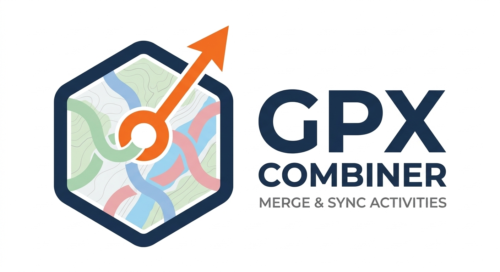
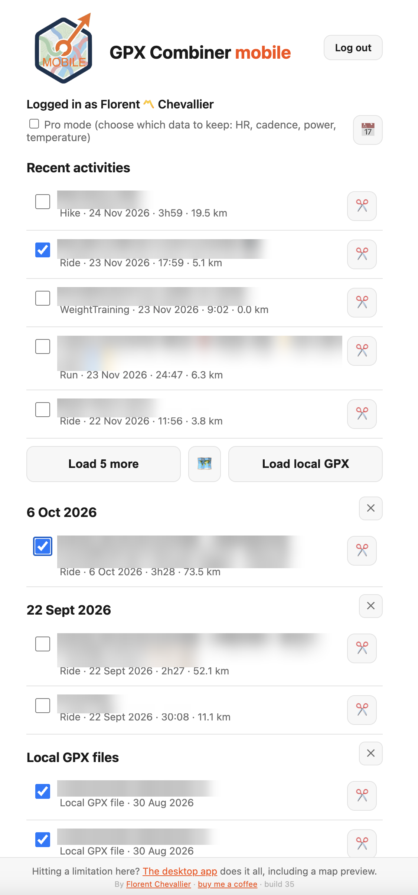
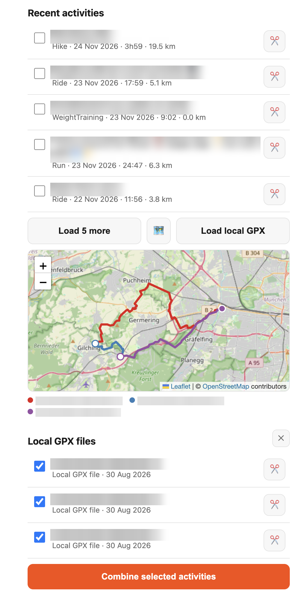
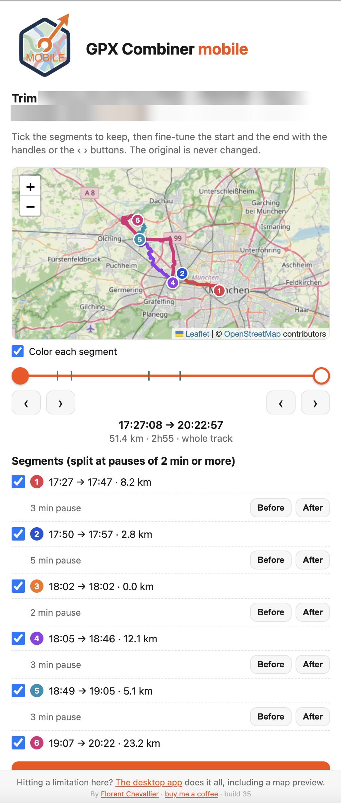
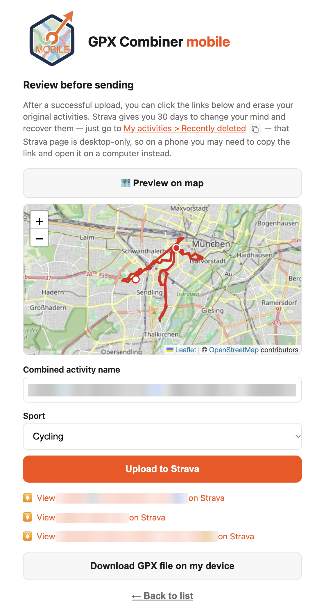
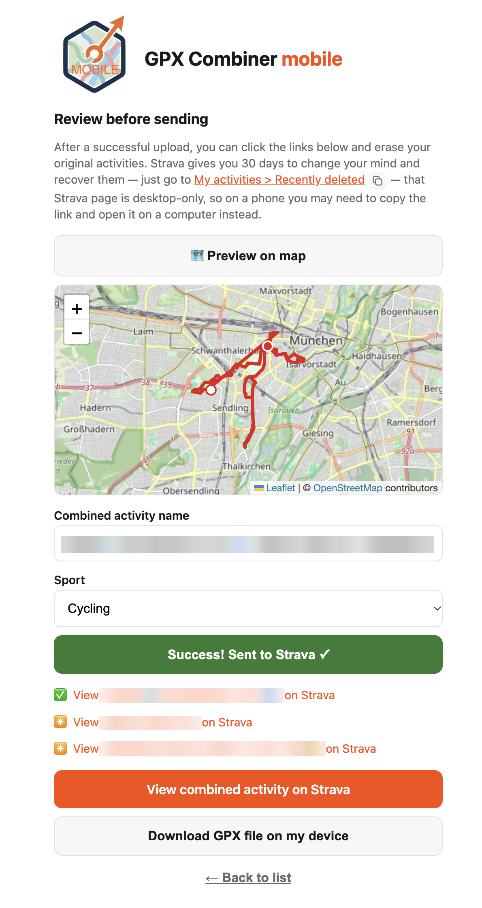

<p align="center">
  
</p>

<h1 align="center">GPX Combiner</h1>

<p align="center">
  Combine Strava activities and GPX files into one, trim them, preview them on a map, and send the result back to Strava — from your phone, your computer, or QGIS.
</p>

<p align="center">
  
  
  
</p>

<p align="center">
  <a href="https://gpxcombiner.onrender.com/"><strong>📱 Open the mobile app</strong></a>
  &nbsp;·&nbsp;
  <a href="https://github.com/florentchevallier/GPX-Combiner/releases/latest"><strong>⬇ Download the desktop app (macOS / Windows)</strong></a>
</p>

---

## Which one is for me?

|  | Mobile app | Desktop app | QGIS plugin |
|---|---|---|---|
| **Runs on** | Your phone's browser, installable on the home screen | macOS, Windows (Linux from source) | QGIS 3 |
| **To install** | Nothing | A download | A `.zip` to add to QGIS |
| **Strava** | Log in with your Strava account | Your own Strava API application (one-time setup) | Same as the desktop app |
| **Combine Strava activities and local GPX files** | ✓ | ✓ | ✓ |
| **Trim a track at its pauses** | ✓ | Not yet | — |
| **Map preview** | ✓ | ✓ | ✓ (as QGIS layers) |
| **Send the result to Strava** | ✓ | ✓ | ✓ |
| **Status** | Open beta, limited to 10 Strava users for now | Released | Beta |

The mobile app is the quickest way in: nothing to install or set up, and it works right after your ride, from the train or the hotel. The desktop app offers more Strava browsing options and works without any server.

## Table of contents

- [Mobile app](#mobile-app)
- [Desktop app](#desktop-app)
- [QGIS plugin](#qgis-plugin)
- [Privacy](#privacy)
- [License](#license)
- [Roadmap](#roadmap)
- [For developers](#for-developers)
- [Changelog](#changelog)

## Mobile app

👉 **[gpxcombiner.onrender.com](https://gpxcombiner.onrender.com/)** — open it on your phone and log in with Strava (or continue without Strava, for local GPX files only).

<p align="center">
  
  
  
  
  
</p>

**Install it on your home screen** for a full-screen app without the browser bar: in Chrome on Android, open the ⋮ menu and choose **Install** (pick "Install" rather than "Create shortcut" if both are offered); in Safari on iPhone, tap the Share icon, then **Add to Home Screen**. The login screen shows an install button when the browser supports it.

### What it does

- **Combine any mix** of your recent Strava activities (5 at a time, up to 10 — 20 in Pro mode), the activities of **any day you pick** with 📅 in the phone's own calendar, and **GPX files** from your phone. Each source has its own section; tick what you want, across sections, and everything is put in chronological order.
- **Or send a single item on its own**: upload a GPX file from your phone, or a copy of an existing activity — typically a trimmed one.
- **Trim before using** (✂️ next to each item): the pauses found in the track (2 minutes or more without recording, or a jump in position — e.g. a recording paused during a bus ride) split it into numbered segments, shown on a map. Tick the ones to keep, even non-adjacent ones, with Before/After shortcuts on each pause; then fine-tune the start and the end with two handles, or point by point with the ‹ › buttons. "Color each segment" helps on tangled tracks. Only what's kept is used; the original is never changed.
- **Map preview** (🗺️): the selected activities and files, each in its own color, or the combined track on the review screen.
- **Pro mode**: choose which of heart rate, cadence, power and temperature to keep in the combined file.
- **Review, then send**: edit the name (the source names joined by " + ") and the sport, then upload to Strava, download the GPX to your phone, or both. A successful upload shows in place, with a link to the new activity.
- **No duplicate error**: the combined file starts one second before its first source, so Strava accepts it even while the originals still exist. Delete them afterwards with the direct links on the review screen — the app never deletes anything for you. Strava keeps deleted activities recoverable for 30 days (the review screen links to its "Recently deleted" page, which is desktop-only: a copy button lets you open it on a computer).
- **Continue without Strava**: no account needed to combine and download local GPX files.
- The combined GPX gets its own `<name>`, a `creator="GPX Combiner"` attribute and a link/description signature in `<metadata>`, the same conventions as the desktop app and the QGIS plugin.

### Good to know

- **Strava limits the number of users**: the app can be connected to 10 Strava accounts at most for now. Logging out of the app keeps your place; to free it, use **Disconnect from Strava** under your name in the app, or remove GPX Combiner from **Settings → My Apps** on the Strava website.
- **The first load can take a while**: the app runs on a free host that sleeps when nobody uses it, and wakes up in a few dozen seconds.
- The interface is in English only.
- No version number for now: it changes quickly while it's being tried out. A small "build N" in the footer shows which version you're looking at.

## Desktop app

A local app for macOS and Windows (or any OS from the Python source) that combines GPX files, imports activities from Strava and previews them on a map.

### Download

Prebuilt, ready-to-run apps are published on the [**Releases**](https://github.com/florentchevallier/GPX-Combiner/releases) page — no Python installation needed. Download the `.app`/`.dmg` for macOS or the `.exe`/`.zip` for Windows from the **Assets** section of the [latest release](https://github.com/florentchevallier/GPX-Combiner/releases/latest). To run the Python script directly instead (any OS, always the latest source), see [For developers](#run-the-desktop-app-from-source).

> **Unsigned build warning:** these builds aren't signed with a paid Apple/Microsoft developer certificate, so:
> - **macOS:** Gatekeeper will say the app "cannot be opened" the first time — right-click (or Control-click) the app → **Open** → **Open** again in the dialog. You only need to do this once.
> - **Windows:** SmartScreen may show "Windows protected your PC" — click **More info → Run anyway**.

### What it does

- **Combine multiple GPX files** into one, in chronological order — handy for splitting a long ride/run into segments on your GPS device and merging them back into a single activity afterwards.
- **Import activities directly from Strava**: browse your recent activities (with pagination, date filtering, a choice of 10/25/50 per page, and each activity's gear shown), pick the ones you want, and download them as GPX — Strava's API doesn't offer a direct GPX export, so the app rebuilds one from the underlying GPS/altitude/time (and optionally heart rate/cadence/power/temperature) data streams.
- **Upload the combined result straight back to Strava**, with an activity-type dropdown. As on mobile, the combined file starts one second before its first source, so Strava doesn't reject it as a duplicate; once uploaded, the app offers to open the original activities (each in a tab, or your Activities page) so you can delete them yourself (Strava keeps deleted activities recoverable for 30 days).
- **Preview tracks on a map** before combining: an OpenStreetMap view with each track in its own color, start/finish markers, and a legend.
- **Keep or drop extra sensor data**: each file shows which of HR / cadence / power / temperature it contains, and you can choose which of those to keep in the combined output.
- **Open the saved file's folder** straight from the confirmation after saving.
- **Multi-language interface**: French, English, Spanish, German.

### Connecting Strava

Strava requires every app — including one running on your own computer — to be registered with a **Client ID** and **Client Secret** before it can request your data. This is a one-time setup, entirely on Strava's side; nothing is shared with anyone but Strava and your own computer. (Not needed for the mobile app, which uses its own registration.)

1. **Log in to Strava**, then go to your API settings page:
   👉 **https://www.strava.com/settings/api**
   (this is the same as "Settings → My API Application" from your Strava profile menu)

2. **Create an application.** You'll be asked for:
   | Field | What to put |
   |---|---|
   | **Application Name** | Anything you like, e.g. `GPX Combiner` |
   | **Category** | Any category fits — e.g. *Visualizer* |
   | **Club** | Leave blank |
   | **Website** | `http://localhost` (or any URL — Strava requires something here, but it isn't actually used by this app) |
   | **Application Icon** | Strava requires you to upload an image to complete this form. Any square-ish image works — the app's logo [here](https://raw.githubusercontent.com/florentchevallier/GPX-Combiner/refs/heads/main/Art/Logo/Logo_v3_square.png), or even just a placeholder picture. It's only shown on Strava's own site, never inside GPX Combiner. |
   | **Authorization Callback Domain** | **`localhost`** — this one matters. GPX Combiner runs a tiny, temporary local web server on your own computer to receive Strava's authorization response, and Strava will refuse the connection if this field isn't set to exactly `localhost`. |

3. **Save.** Strava will show you a **Client ID** (a short number) and a **Client Secret** (a longer string, hidden behind a "Show" button).

4. **Back in GPX Combiner**, click **"Import from Strava…"** (or **⚙ Strava settings → Connect…**). The first time, it'll ask for these two values — paste them in, and it'll walk you through the rest:
   - Your browser opens Strava's authorization page.
   - Click **Authorize**.
   - You'll see a small "you can close this window" confirmation — switch back to the app, and your activities will load.

Your Client ID/Secret and access tokens are saved **only** in a `strava_config.json` file next to the script on your own computer — never sent anywhere except directly to Strava's API. You can revoke access and erase everything at any time from **⚙ Strava settings → Disconnect and erase credentials**.

> **Already connected from an older version?** Uploading to Strava needs a wider permission (`activity:write`, not just read access) than earlier versions requested. The next time you use Import or Upload, Strava will ask you to re-authorize — this is expected, a one-time step.

### Using the app

1. **Add tracks** — drag and drop GPX files onto the list, use the **"Add GPX files"** button, or import them straight from Strava.
2. Files are automatically **sorted chronologically** (by their first timestamp).
3. Click **"Preview"** to see all loaded tracks overlaid on a map, each in its own color, with start/finish markers.
4. Choose which extra data to keep — **HR / Cadence / Power / Temp** — using the checkboxes above the combine button (only shown if at least one loaded file actually contains that data).
5. Click **"Combine and save"** and pick where to save the result.
6. Optionally, click **"Upload to Strava"** to send the combined file straight to your account — pick an activity name and type (pre-filled from the file itself), and it'll upload and let you know once Strava has finished processing it.

### Troubleshooting

<details>
<summary><strong>The app crashes on launch / "Python quit unexpectedly"</strong></summary>

This is almost always a broken Tcl/Tk install from Homebrew. See [Run the desktop app from source](#run-the-desktop-app-from-source) — installing/repairing `python-tk` and restarting your Mac fixes this in most cases.
</details>

<details>
<summary><strong>Strava activities won't load / a certificate error appears in Terminal</strong></summary>

This means Python can't verify Strava's SSL certificate.

- **Downloaded app (from Releases):** this shouldn't happen — the app bundles its own trusted certificates (`certifi`). If you still hit this, please [open an issue](https://github.com/florentchevallier/GPX-Combiner/issues).
- **Running from source:** common with the official python.org installer, which doesn't reuse macOS's system certificates. Easiest fix — install `certifi` so the app uses its bundled CA list instead of the system one:
  ```bash
  pip3 install certifi
  ```
  Alternatively (or if that doesn't help), reinstall Python's own certificates:
  ```bash
  python3 --version   # note your version number

  open "/Applications/Python 3.13/Install Certificates.command"   # adjust 3.13 to match
  ```
</details>

<details>
<summary><strong>Strava authorization fails with "Authorization Error" / "Application ... invalid"</strong></summary>

Double-check the **Client ID** and **Client Secret** you entered match exactly what's currently shown on your app's page at strava.com/settings/api (if you ever click "Generate a new client secret" there, the old one stops working immediately). Use **⚙ Strava settings → Disconnect**, then reconnect with fresh values.
</details>

<details>
<summary><strong>The browser opens for Strava authorization, confirms success, but the app never loads anything</strong></summary>

Make sure your Strava application's **Authorization Callback Domain** is set to exactly `localhost` (see [Connecting Strava](#connecting-strava), step 2). This is the single most common misconfiguration.
</details>

## QGIS plugin

A companion QGIS plugin lets you load GPX tracks as styled QGIS layers (with an OpenStreetMap basemap and directional arrows), import activities from Strava (with gear shown per activity), upload the combined result back to Strava, and combine/export — without leaving QGIS. It connects to Strava the same way as the desktop app (see [Connecting Strava](#connecting-strava)).

**Status: beta, tested on macOS only so far** — the code is platform-independent Python/Qt/QGIS APIs, but Windows/Linux haven't been verified yet.

**Requires QGIS 3.x — not compatible with QGIS 4.** This is enforced in `metadata.txt` (`qgisMaximumVersion=3.99.0`), so QGIS 4 won't offer to install it. QGIS 4 support is on the [roadmap](#roadmap) once the plugin is out of beta and more thoroughly tested — not before.

The plugin's window title shows its own version (e.g. `GPX Combiner v0.3.11-beta`), handy if you have more than one install around (a dev symlink and a separately installed `.zip`, say) and need to tell at a glance which one you're looking at.

### Install the beta

The plugin's `.zip` is published alongside the desktop app on each [**GitHub release**](https://github.com/florentchevallier/GPX-Combiner/releases).

1. Download the `gpx_combiner-<version>-beta.zip` file from the [latest release](https://github.com/florentchevallier/GPX-Combiner/releases/latest)'s **Assets**
2. In QGIS: **Plugins → Manage and Install Plugins → Install from ZIP**, select the downloaded file
3. If it doesn't show up afterward, check "Show also experimental plugins" under **Plugins → Manage and Install Plugins → Settings** — this beta is still flagged experimental

Not yet published to the official QGIS plugin repository (the list QGIS shows automatically without needing a `.zip`) — see the [changelog](CHANGELOG.md) for what's implemented so far, and please [report issues](https://github.com/florentchevallier/GPX-Combiner/issues) you run into, especially on Windows/Linux.

## Privacy

None of the three tools has analytics, ads or tracking of any kind.

**Mobile app**
- Logging in with Strava gives the app's server a token to read your activities and upload new ones on your behalf. It is stored on that server (one per Strava account), used only to call Strava for you, and erased whenever the free host restarts — you then simply log in again.
- Your activities and GPX files go through the server only to be combined; nothing is kept once the result is sent back to your phone or to Strava.
- Map tiles come from OpenStreetMap, and the map library from unpkg.com, loaded directly by your browser.
- You can remove the app's access to your Strava account at any time with **Disconnect from Strava** in the app, which also erases your token from the server, or from **Settings → My Apps** on the Strava website.

**Desktop app and QGIS plugin**
- All data stays local: GPX files, Strava credentials, and downloaded activities are only ever written to your own computer.
- The only network calls are to Strava's official API (`strava.com`) when you explicitly use the Strava import/upload features, to OpenStreetMap's Nominatim service (`nominatim.openstreetmap.org`) to resolve an activity's starting city in the desktop app's Strava import list, and to OpenStreetMap's tile server for the map.

**Deleting activities is never automated**, in any of the three: there is no `DELETE /activities/{id}` endpoint in Strava's API, and scripting the website's own delete button would bypass its CSRF protection — a line this project won't cross even if it were technically possible. The apps only ever give you a direct link to delete an activity yourself.

## License

[GPL-3.0-or-later](LICENSE) — applies to the whole repository (mobile app, desktop app, `core/`, and the QGIS plugin).

## Roadmap

Not commitments, just things worth doing once the essentials are solid:

- Bring the mobile app's trimming (segments at pauses) to the desktop app.
- **QGIS 4 support** — once the plugin is out of beta and reasonably battle-tested on QGIS 3.x across platforms. Not started.
- Full pagination (10/25/50 per page + date range filter) for the plugin's Strava import, matching the desktop app's.
- Publish the plugin to the official [QGIS Plugin Repository](https://plugins.qgis.org/) (currently install-from-ZIP only).
- Verify Windows/Linux compatibility for the plugin.
- Migrate the desktop app to actually import `core/` instead of carrying its own copy of the same logic, so the two stop being able to drift apart.

## For developers

The repository holds the three tools side by side: [`mobile-app/`](mobile-app/) (Flask backend + single-page vanilla-JS frontend), [`gpx_combiner.py`](gpx_combiner.py) (desktop app, Tkinter, Python standard library only), [`qgis-plugin/`](qgis-plugin/), and [`core/`](core/), the GPX-combining and Strava logic shared by the mobile app and the QGIS plugin. The desktop app still carries its own self-contained copy of the same logic rather than importing `core/` (unifying them is on the [roadmap](#roadmap)).

### Run the desktop app from source

Requires Python 3.9 or later — the app uses only Python's standard library, no dependencies for the core features. If you don't already have Python, download the latest stable version from [python.org/downloads/macos](https://www.python.org/downloads/macos/) (macOS) or [python.org/downloads/windows](https://www.python.org/downloads/windows/) (Windows) and install it.

Then, from Terminal (macOS/Linux) or Command Prompt (Windows), run the app with:

```bash
python3 "/path/to/gpx_combiner.py"
```

**On macOS, if that doesn't work**, it's almost always a Tk (the GUI toolkit) issue with a Homebrew-installed Python. Fix it with:

```bash
# Install Homebrew if you don't have it: https://brew.sh

# Install/repair Tk support
brew install python-tk

# Make sure everything is current
brew update
brew upgrade tcl-tk
brew reinstall python-tk@3.13   # replace 3.13 with your own Python version
```

Then confirm Tk works on its own:

```bash
python3 -c "import tkinter; tkinter._test()"
```

A small test window should pop up. If it does, the app itself should now launch normally.

**On Windows or Linux**, the app runs the same way (`python3 gpx_combiner.py`). Tk ships with most Python installers already; if not, install your distro's `python3-tk` package (Linux) or re-run the Python installer with the "tcl/tk" option checked (Windows).

**Optional: drag-and-drop.** Dragging GPX files straight into the app window needs the small third-party `tkinterdnd2` package (`pip3 install tkinterdnd2`). Without it, the app works exactly the same — you just use the "Add GPX files" button instead of dragging files in.

### Package the desktop app yourself

Want to build your own `.app`/`.exe` instead of using the one from [Releases](https://github.com/florentchevallier/GPX-Combiner/releases)? See `py2app_setup.py` (uses [py2app](https://py2app.readthedocs.io/)):

```bash
pip3 install py2app certifi
python3 py2app_setup.py py2app -A     # fast "alias" build, for testing
python3 py2app_setup.py py2app        # full standalone build, in dist/
```

Note: without an Apple Developer certificate and notarization, macOS Gatekeeper will show a warning the first time you open an unsigned build (right-click → Open bypasses this once).

### Run the mobile app yourself

```bash
cd mobile-app
pip3 install -r requirements.txt   # Flask, requests, python-dotenv, gunicorn
cp .env.example .env               # then fill in STRAVA_CLIENT_ID, STRAVA_CLIENT_SECRET, FLASK_SECRET_KEY
PYTHONPATH=.. python3 app.py       # PYTHONPATH must point at the repo root so "core/" is importable
```

Visit `http://localhost:5000`. For a real deployment, set the same variables as actual environment variables (not a `.env` file) on your host, plus `APP_BASE_URL` (e.g. `https://your-app.onrender.com`), and set that same domain — **case-sensitive** — as the Strava application's **Authorization Callback Domain** at [strava.com/settings/api](https://www.strava.com/settings/api). Run with `gunicorn app:app` rather than the Flask dev server.

- **One Strava application for everyone:** all users authorize against the **same** Client ID/Secret (Strava natively supports this — it's not a workaround); each person still logs in with their **own** Strava account and only ever sees/combines their own activities. Tokens are stored per user (keyed by Strava athlete id) in a local SQLite database, refreshed automatically. Strava caps how many athletes one application can connect (10 without a review by Strava).
- **Hosting limitation:** the current deployment uses a free-tier host whose local disk (including the SQLite token store) is wiped on every restart/spin-down after inactivity — fine for a small group re-authorizing occasionally, but not for a wider audience.
- `.env` (secrets) and `*.db` (the SQLite file, which holds every user's Strava tokens) must **never** be committed — both are in `.gitignore`.

### Run the QGIS plugin from source

If you'd rather work straight from a repo checkout instead of installing the packaged `.zip`:

```bash
# From this repo, inside qgis-plugin/: link core/ in so it's reachable
# from inside the plugin folder (QGIS only ever sees qgis-plugin/ in isolation)
cd qgis-plugin
ln -s ../core core

# Then symlink the whole qgis-plugin/ folder into your QGIS profile's plugins folder:
#   macOS:   ~/Library/Application Support/QGIS/QGIS3/profiles/default/python/plugins/
#   Windows: %APPDATA%\QGIS\QGIS3\profiles\default\python\plugins\ (needs Developer Mode
#            enabled, or an elevated command prompt, to create symlinks)
#   Linux:   ~/.local/share/QGIS/QGIS3/profiles/default/python/plugins/
ln -s "$(pwd)" "<profile plugins folder>/gpx_combiner"
```

Then enable "GPX Combiner" the same way as in [Install the beta](#install-the-beta). To build your own `.zip` from source instead (e.g. after making changes), see [`build_plugin_zip.py`](build_plugin_zip.py) — it stages a clean copy (physically bundling `core/`, no symlinks or dev cruft) into `dist/`.

## Changelog

See [`CHANGELOG.md`](CHANGELOG.md) for the full version history of the desktop app and the QGIS plugin. The mobile app has no version number for now; its history is in the commits.

---

<p align="center"><sub>Desktop app version 3.8.1</sub></p>
